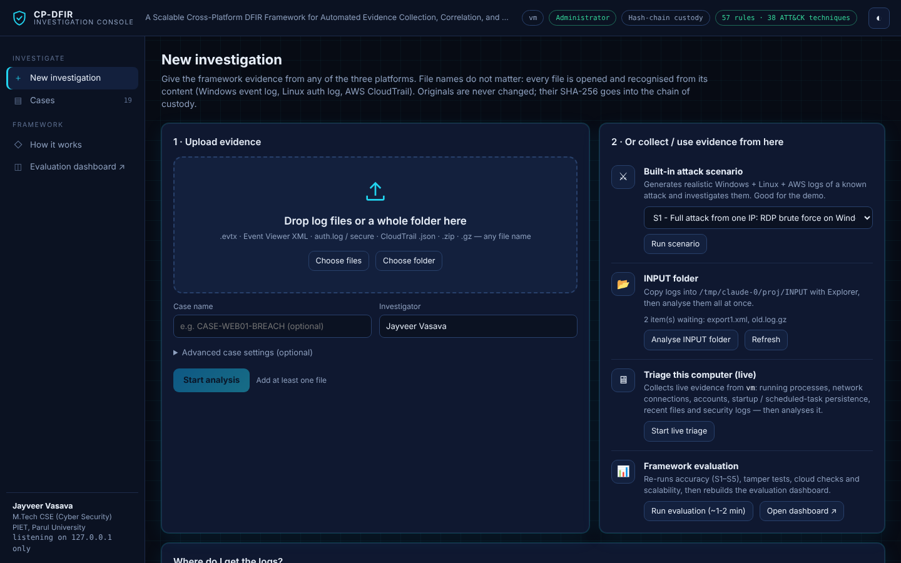
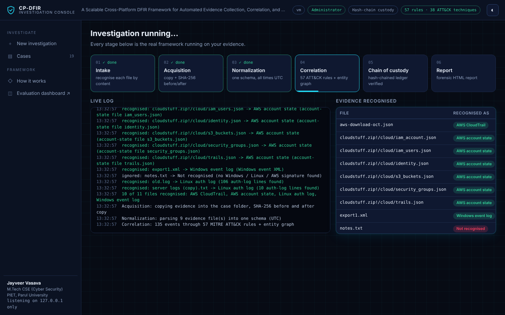
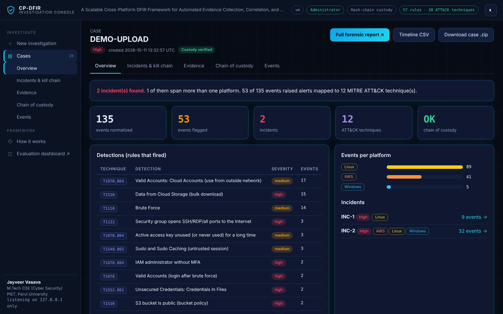
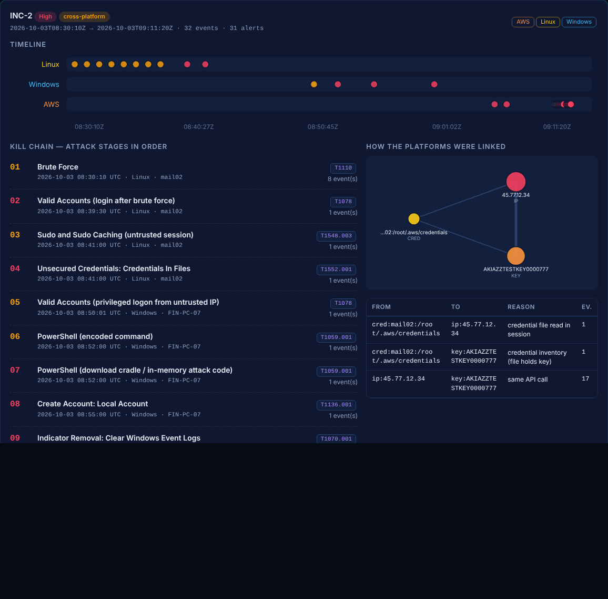

<div align="center">

# Cross-Platform DFIR Framework

**A Scalable Cross-Platform DFIR Framework for Automated Evidence Collection, Correlation, and Cloud Forensic Investigation**

M.Tech Dissertation (Phase II) · Computer Science & Engineering – Cyber Security
Parul Institute of Engineering & Technology (PIET), Parul University

**Jayveer Vasava** (2503032330032) · Guide: Dr. Ankita Gandhi · Co-guide: Dr. Kruti Kamal Sutaria

[**▶ Live console — upload logs and investigate in the browser**](https://jayveerv.github.io/cross-platform-dfir-framework/) ·
[Evaluation dashboard](https://jayveerv.github.io/cross-platform-dfir-framework/dashboard.html) ·
[Sample forensic report](https://jayveerv.github.io/cross-platform-dfir-framework/report_S1.html) ·
[How to run](#how-to-run)

</div>

---

One attack today rarely stays on one machine. An attacker can brute-force a **Windows** workstation, move to a
**Linux** server, read stored cloud keys and then misuse an **AWS** account. Each platform keeps its evidence in a
different format and is examined with a different tool, so the investigator has to join the pieces by hand and
keep the chain of custody separately.

This framework collects the evidence from all of these sources, converts it into one common schema, links related
events into incidents through an entity graph, maps every finding to **MITRE ATT&CK**, and records every step in a
**tamper-evident chain-of-custody ledger**.

<p align="center"></p>

## Architecture

<p align="center"></p>

| Layer | What it does | Module |
|---|---|---|
| **Acquisition** | Copies evidence and checks SHA-256 before and after copying; live host triage in order of volatility (RFC 3227); read-only AWS account state (List / Get / Describe calls only) | `collect.py`, `hostcollect.py`, `cloudstate.py` |
| **Normalization** | Windows Security / Sysmon / PowerShell (EVTX or XML), Linux auth logs, AWS CloudTrail and host snapshots → 35 event types, all times in UTC | `normalize.py` |
| **Correlation** | 57 ATT&CK-mapped rules in six families and a NetworkX entity graph (attacker IPs, credential files, cloud access keys); every link has a stated reason | `correlate.py` |
| **Reporting** | Self-contained HTML report with incident graph and timeline, CSV timeline, JSON, and the investigation console | `report.py`, `make_dashboard.py` |
| **Chain of custody** | SHA-256 hash-chained ledger, optional HMAC signature and an external anchor hash; re-verified at the end of every run | `custody.py` |

## Investigation console

All results are shown in one offline page, organised around the title of the work:
collection, cross-platform correlation, cloud forensics, chain of custody, ATT&CK coverage, scalability and
validation on real data. **[Open it live →](https://jayveerv.github.io/cross-platform-dfir-framework/dashboard.html)**

<p align="center"></p>

| Attack investigation | MITRE ATT&CK coverage |
|---|---|
|  |  |
| **Chain of custody** | **Cloud forensics (AWS)** |
|  |  |

## Web console: upload evidence and investigate

**[Try it live →](https://jayveerv.github.io/cross-platform-dfir-framework/)** No installation: the page loads the
framework's own Python modules into the browser with [Pyodide](https://pyodide.org) (CPython compiled to
WebAssembly) and runs the same intake → normalization → correlation → chain-of-custody → report pipeline there.
**Evidence files are never uploaded**; they are analysed on the visitor's computer. Live triage, the INPUT folder
and AWS collection read a real computer or AWS account, so they are only in the desktop version below.

`start_web.bat` (or `python main.py web`) starts a local web application on **http://127.0.0.1:8765**
(this computer only; nothing leaves the machine). The investigator does not rename files or type paths:

- **Drag and drop** logs or a whole folder. Every file is recognised by its **content**, not its name
  (EVTX signature, Windows event XML, Linux auth-log lines, CloudTrail records, host/cloud artefacts, `.zip`, `.gz`).
  Unrecognised files are listed and left out.
- Or run a **built-in attack scenario** (S1–S5), analyse everything in the **`INPUT/` folder**, or start a
  **live triage** of the computer.
- The pipeline runs **stage by stage on screen**: intake → acquisition → normalization → correlation → chain of custody → report.
- Each case shows a verdict, the rules that fired, every incident's **timeline, kill chain and entity graph**, the
  evidence with its SHA-256, a searchable event table, **re-verification** of the custody ledger and a
  **tamper test on a copy** of the case. The HTML report, timeline CSV and the whole case (.zip) can be downloaded.

The SHA-256 of every original file is written to `intake_manifest.json`, which becomes the **first entry of the
custody ledger**, before the normal acquisition (hash before and after copying) runs.

| Upload and choose a source | Pipeline running live |
|---|---|
|  |  |
| **Case overview** | **Incident: timeline, kill chain, entity graph** |
|  |  |

## Results

All numbers below are measured by `python main.py evaluate` and `python main.py real-eval`
(full output in [`results/`](results/)).

**Simulated multi-platform attacks (ground truth written by the generator)**

| Measure | Result |
|---|---|
| Correlation F1, core scenarios S1–S4 | **1.000** (precision 100%, recall 100%) |
| Hard cases S5 (session collision, insider from an internal IP) | F1 0.783; 0.963 with the admin-source policy |
| Attack chain captured in one incident (S1–S3): best single platform vs unified | 42–100% vs **100%** |
| Tampering attacks detected / untouched cases verified | **25 / 25**, 5 / 5 |
| AWS misconfigurations found (moto emulator, all regions, read-only) | **15 / 15**, 0 false positives, 22 API operations |
| Scalability | 104,634 records in 6.25 s (≈16,700 records/s), F1 1.000 |

**Real public data**

| Dataset | Result |
|---|---|
| EVTX-ATTACK-SAMPLES (278 Windows attack captures, 37,364 records) | 0 parse errors; 25 / 26 labelled samples detected; 0 / 5 hard cases |
| LogHub OpenSSH_2k and Linux_2k | Brute-force source IPs match an independent count (11 / 11, 39 / 39) |
| Stratus Red Team CloudTrail samples (cloudtrail2sightings) | 4 / 4 attacks detected |

**Limitations, stated openly.** Detection is rule-based. Rules were refined after looking at the real samples, so
the real-data figures are development-set results. The false-positive rate on real benign traffic and correlation
on a real multi-platform incident were not measured. The AWS collectors were tested on an emulator, not a live
AWS account.

## How to run

**Windows (no command line needed)**

1. Install Python 3.10 or newer from [python.org](https://www.python.org/downloads/) (tick *Add Python to PATH*).
2. Download this repository (**Code → Download ZIP**) and extract it.
3. Double-click **`start_web.bat`** to open the web console (recommended), or **`run.bat`** for the menu:

```
W. Web console: upload logs in the browser, live analysis
I. Analyse every file in the INPUT folder (any file names)
1. Demo: simulated attack across Windows, Linux and AWS
2. Full evaluation on simulated scenarios, about 1 minute
3. Validation on REAL public data, downloads 44 MB first time, about 3 minutes
4. Tampering demo
5. Analyse my own logs
6. Export this laptop's Windows Security log, run as Administrator
7. Pull AWS CloudTrail events and account state, needs AWS credentials
8. Self-tests
9. TRIAGE this laptop: collect live evidence, analyse, report
```

4. Double-click **`view_dashboard.bat`** to open the investigation console.

**Any operating system (command line)**

```bash
pip install -r requirements.txt          # networkx, python-evtx, boto3, psutil, flask
python main.py web                        # web console on http://127.0.0.1:8765
python main.py inbox                      # analyse every file in INPUT/ (any names, .zip/.gz)
python main.py demo                       # simulated attack -> cases/DEMO/report.html
python main.py evaluate                   # all scenarios, tamper tests, scalability
python main.py tamper-demo                # change evidence and watch it being detected
python main.py analyze --input <folder>   # your own windows_security.xml / *.evtx, auth.log, cloudtrail.json
python main.py triage                     # live evidence from this computer
python main.py verify --case cases/DEMO   # re-verify the chain of custody

pip install -r requirements-dev.txt       # adds moto and freezegun
python main.py selftest                   # 54 automated tests
```

## Repository layout

```
main.py              command-line entry point (14 commands)
webapp.py, web/      web console (Flask, 127.0.0.1): upload, live pipeline, cases, custody tests
intake.py            recognises evidence files by content (any name, .zip, .gz, folders)
collect.py           acquisition with hashing, Windows/AWS/Linux collectors
hostcollect.py       live host triage (Windows, Linux, macOS)
cloudstate.py        read-only AWS account-state collector
normalize.py         common schema (35 event types, UTC)
correlate.py         57 ATT&CK rules and the entity graph
custody.py           hash-chained, optionally HMAC-signed ledger
pipeline.py          runs the four layers for one case
report.py            HTML forensic report
make_dashboard.py    investigation console
evaluate.py          scenarios S1-S5, tamper tests, ablation, scalability
generate_data.py     simulated attacks with ground truth
realdata.py          validation on public datasets
cloud_emulation.py   AWS tests on the moto emulator
tests/               54 automated tests
INPUT/               drop folder for "python main.py inbox"
results/             evaluation output used in the dissertation
casestore.py         case operations shared by the desktop and the in-browser console
make_pages.py        builds docs/ (GitHub Pages): the console running the framework in the browser
docs/                in-browser console (index.html), evaluation dashboard, sample report, images
```

17 Python modules (6,144 lines) plus the web console (HTML/CSS/JS, 584 lines); standard library plus `networkx`, `python-evtx`, `boto3`, `psutil` and `flask`.

## Citation

If you refer to this work, please cite the dissertation:

```
J. Vasava, "A Scalable Cross-Platform DFIR Framework for Automated Evidence Collection, Correlation,
and Cloud Forensic Investigation," M.Tech dissertation, Dept. of Computer Science & Engineering
(Cyber Security), Parul Institute of Engineering & Technology, Parul University, 2026.
```

## License

Released under the [MIT License](LICENSE).
Public datasets used for validation belong to their authors: EVTX-ATTACK-SAMPLES (sbousseaden), LogHub (logpai) and
the Stratus Red Team CloudTrail samples in cloudtrail2sightings (zmallen); they are downloaded at run time and are not included in this repository.
